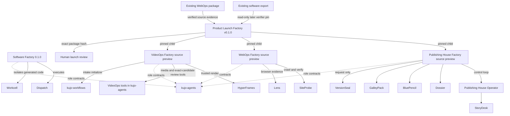

# Factory dependencies and evidence boundaries

Research date: 2026-11-13. Exact source revisions, lock contents, npm versions, claim evidence and source-file hashes are in [the capability matrix](capability-matrix.json). This map distinguishes execution from source installation and contract reuse. It does not imply a common controller or universal sandbox.

The Software Factory export adapter in Product Launch is pinned to `259aff26e3ca627873eec6b40a89d6942b039d7c`, whereas standalone Software Factory `0.1.0` resolves to `cfddc146e225229a9c15d3bf8ad2bfc01e2c8e24`. Product Launch does not invoke the software application builder. The diagram deliberately does not draw an execution edge from Product Launch to the standalone builder.

## Relationship classes

| Class | Verified use |
| --- | --- |
| Direct runtime dependency | Software runs Dispatch/Workcell; Publishing runs its canonical operator and editorial tools; WebOps runs SiteProbe/Lens; VideoOps runs canonical intake/review tools and HyperFrames; Product Launch invokes pinned domain adapters. Kujo runtime is installed directly in the four domain factories and inherited through children by Product Launch. |
| Pinned source dependency | Every `sources.lock.json` records exact Git commits. Publishing installs Dispatch and Agents SDK for operator layout without scheduling its workers through them. PressWire receives local initialization/doctor checks, but no publication effects. Being installed does not prove active production use. |
| Build-time dependency | The website uses Kujo SSG, SiteKit and Howl for publication assets. They are not factory runtime dependencies. HyperFrames executes during VideoOps production, so it is classified as a runtime production dependency rather than merely website build tooling. |
| Workflow or contract integration | Canonical Chain of Command, editorial and WebOps role contracts; WebOps finding-to-fix permission/stage boundary; VideoOps production intake; Product Launch software-export acceptance. These do not confer a general shell or publication authority. |
| Optional integration | Canonical VideoOps media services and Product Launch narration support separately authorized speech or existing audio. Silent example runs do not make paid media calls. |
| Related ecosystem tool | SiteKit, Kujo SSG and Howl belong to the wider publishing/developer experience. Their relationship to the website must not be presented as factory execution. |
| Proposed or experimental integration | Broader Software Factory ecosystem integration on local feature branches is outside standalone `0.1.0`. Spec, Eval, ShipCheck, RunLedger, Casefile and Lens are not evidenced as dependencies of that released factory. Generic watchdog behavior in trusted isolation code does not establish use of the Watchdog product. |

## Evidence crossing factory boundaries

| Producer | Artifact / contract | Consumer and check | Rejection / authority |
| --- | --- | --- | --- |
| Software Factory | `kujo.factory.export/v1` source/run/test evidence inventory | Product Launch's separately pinned portable verifier validates existing export bytes and identity | Invalid export blocks intake; no new software run or authenticated approval is implied. |
| WebOps Factory | `kujo.webops-factory.package/v1`, before/after findings, retained state | Product Launch source station requires a checked package, expected review state and empty supported findings | Drift, wrong shape or wrong state blocks intake. Source package is existing product evidence. |
| Owner/source station | Frozen brief, captured text, product visuals and hashes | Publishing House receives permitted source IDs and local snapshots | Unknown claims/source IDs and changed inputs block work; provenance URL is not web retrieval. |
| Publishing House | `kujo.publishing-house-factory.package/v1`, reviewed article/adaptations, escaped landing copy, source and review lineage | Coordinator creates bounded static page and invokes WebOps | Model review does not approve publication; editorial revision exhaustion remains blocked. |
| WebOps | Website candidate, patch, SiteProbe/Lens records and screenshot | Coordinator inventories website handoff and registers checked screenshot for VideoOps | Unsupported active content or failed checks prevents a website handoff. No original site mutation. |
| VideoOps | MP4, editable composition, metadata and `videoops-review-decision/v1` | Coordinator collects exact candidate and remaining human review requirement | Technical success does not turn `REVIEW_INCOMPLETE` into perceptual approval. |
| Coordinator | `kujo.product-launch.handoff/v1` input identity, factory revisions, child output inventory and upstream hashes | Resume verifies prior handoffs before reuse; final manifest collects all outputs | Changed inputs require new version. Edited, added or deleted packaged files invalidate local approval. |
| Human reviewer | Exact package hash plus reviewer and video-review acknowledgment | Product Launch records local approval | Approval remains local; no deployment/publication API exists. Export omits local approval. |

Source implementations: [Software export](https://github.com/kujolang/software-factory/blob/cfddc146e225229a9c15d3bf8ad2bfc01e2c8e24/factory/export.mjs), [Publishing adapter](https://github.com/kujolang/publishing-house-factory/blob/38e7900a16f8482d12ad6b8b6a15f538d7ee3099/src/editorial.py), [WebOps controller](https://github.com/kujolang/webops-factory/blob/a2aba2c63777f37bf47d64dc93748949658b977b/src/factory.py), [VideoOps runner](https://github.com/kujolang/videoops-factory/blob/dcf2dc4fa7311f59ba3dd16f58a227439a155979/src/runner.mjs), [Launch coordinator](https://github.com/kujolang/product-launch-factory/blob/d61c7021b0469c45f909b8371205f0df3afbac8b/src/launch.py), [launch integrity/approval](https://github.com/kujolang/product-launch-factory/blob/d61c7021b0469c45f909b8371205f0df3afbac8b/src/core.py).

## Shared patterns, distinct implementations

The factories share local run directories, JSON receipts, byte inventories, preserved failures, separated proposal/review calls and human review boundaries. Their schema names and controllers differ. A generic JSON hash list does not imply that an arbitrary factory can consume another's output. Product Launch implements explicit adapters for the accepted packages.

Only Software Factory's released path executes generated application code inside rootless Workcell. Other factories restrict proposals to data and run trusted compilers/tools on the host. This is a different boundary, not universal sandbox inheritance.

The canonical Publishing House Operator owns its checkpoints/leases. Software uses Dispatch; VideoOps uses its own sequential runner; WebOps uses a bounded Python controller; Product Launch owns cross-factory handoffs. There is no universal Software Factory controller.

## Source-inspection record

The audit read each factory's setup and security docs, lockfiles, manifests, command implementations, CI definitions, tests, floor code and retained verification/media records. Pinned upstream README files were also inspected through local Git objects for Dispatch, Workcell, kujo-agents, kujo-workflows, StoryDesk, Dossier, BluePencil, GalleyPack, VersionSeal, PressWire, Agents SDK, SiteProbe and Lens. Factory imports and executable calls, rather than upstream feature lists, determine the relationships above.

Versions observed in those pinned upstream sources: Dispatch 1.4.1, Workcell 1.3.0, kujo-agents 1.5.0, kujo-workflows 0.6.2, StoryDesk 0.3.0, Dossier 0.2.0, BluePencil 0.3.0, GalleyPack 0.2.0, VersionSeal 0.3.0, PressWire 0.2.0, Agents SDK 1.1.3, SiteProbe 0.4.0 and Lens 1.1.1. These source version labels do not independently establish GitHub release existence. Exact commits are authoritative in the matrix.

The later Software Factory [qualification report](https://github.com/kujolang/software-factory/blob/259aff26e3ca627873eec6b40a89d6942b039d7c/docs/RELEASE-QUALIFICATION.md) explicitly blocks a feature-complete integration release. Its absent clean-platform/full-runtime qualification and reported upstream VideoOps validator failure are branch limits, not failures of the website integration or evidence that standalone 0.1.0 contains those capabilities. The [portable verifier](https://github.com/kujolang/software-factory/blob/259aff26e3ca627873eec6b40a89d6942b039d7c/factory/evidence.mjs) uses Node built-ins, reads bounded plain files, rejects unsafe paths/symlinks/hardlinks and validates recorded identities without executing bundle content or issuing approval.
